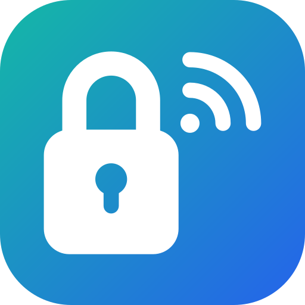
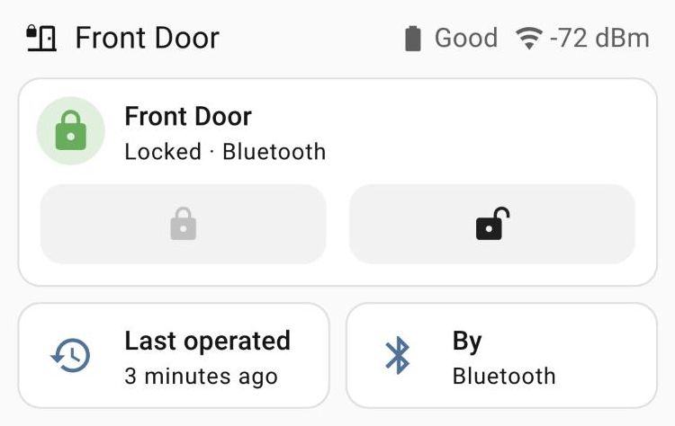

# Level BLE for Home Assistant

[](https://github.com/kkrankall/level-ble/actions/workflows/validate.yml)
[](https://hacs.xyz/docs/faq/custom_repositories)

Local Bluetooth control for **older Level locks** (Level Bolt, Level Lock,
Level Lock Touch) that can't be moved to Matter. Lock and unlock from Home
Assistant through your Bluetooth proxy and follow the lock's state live. No
Level Connect, no HomeKit, no cloud relay.

It speaks Level's own encrypted, signed BLE protocol with your account's key,
exactly like the Level app does.

## Features

- **Lock and unlock** over Bluetooth, through an ESPHome Bluetooth proxy or a
  local adapter
- **Live state without connecting**: locked, unlocked or jammed, read from the
  lock's own advertisements, so manual and keypad changes show up too
- **Who or what operated it last** (manual, keypad, auto-lock, Bluetooth,
  HomeKit, …) and when
- **Battery** (good / low / critical), **firmware version**, **signal
  strength**, and a **door** sensor on locks with door sense
- **Goes unavailable** when the lock stops advertising
- Signs in once during setup. The password is never stored, and after setup
  everything runs locally.
- **Diagnostics** download with secrets redacted

Verified on a real lock (Level product "Apollo", firmware 2.30).

## Install

1. In HACS, open **⋮** → **Custom repositories**. On Home Assistant 2026.11 and
   later, use **Settings** → **Marketplace** instead.
2. Add `https://github.com/kkrankall/level-ble` as an **Integration**.
3. Install **Level BLE** and restart Home Assistant.
4. Go to **Settings** → **Devices & services** → **Add integration** → **Level BLE**.
5. Sign in with your Level account and pick the lock. Add the integration
   once per lock.

You need Home Assistant 2026.10 or later, and its Bluetooth integration with an
adapter or an ESPHome Bluetooth proxy in range of the lock.

The password is used once to unlock your Level keychain and is not stored. The
account key, account UUID and token are kept in the config entry, so **treat
your Home Assistant backups as sensitive**. Accounts with two-factor sign-in
aren't supported yet.

## Entities

Each lock becomes one device with these entities:

| Entity | What it shows |
|---|---|
| Lock | Locked / unlocked / jammed, with Lock and Unlock. `changed_by` names the source of the last operation. |
| Battery | On when the battery is low |
| Battery level | Good, low or critical. Level locks don't report a percentage. |
| Last operated | When the lock last moved, by the lock's own clock |
| Last operated by | Manual, keypad, auto-lock, Bluetooth, HomeKit, Matter, NFC, … |
| Signal strength | dBm of the lock's advertisement, refreshed every minute (diagnostic) |
| Door | Open / closed, only on locks with door sense |

"Bluetooth" covers both the Level app and Home Assistant: the lock can't tell
them apart.

## Dashboard card



This card shows the lock's state, Lock and Unlock buttons, battery, signal
strength and who last operated it. Paste it into **Edit dashboard** → **Add
card** → **Manual**. Your entity IDs depend on the lock's name and area, so
replace `front_door` with yours (they're listed on the lock's device page).

```yaml
type: vertical-stack
cards:
  - type: heading
    heading: Front Door
    icon: mdi:door-closed-lock
    badges:
      - type: entity
        entity: sensor.front_door_battery_level
        show_state: true
        show_icon: true
      - type: entity
        entity: sensor.front_door_signal_strength
        show_state: true
        show_icon: true
  - type: tile
    entity: lock.front_door
    state_content:
      - state
      - changed_by
    icon_tap_action:
      action: more-info
    features:
      - type: lock-commands
  - type: grid
    columns: 2
    square: false
    cards:
      - type: tile
        entity: sensor.front_door_last_operated
        name: Last operated
      - type: tile
        entity: sensor.front_door_last_operated_by
        name: By
```

The lock works with the standard `lock.lock` and `lock.unlock` actions, so you
can use it in automations, scripts and voice assistants like any other lock.

## Troubleshooting

**Settings** → **Devices & services** → **Level BLE** → **⋮** → **Download
diagnostics** includes the advertisement Home Assistant currently sees for the
lock. The token, private key, email, account and lock UUIDs, serial and public
key are redacted.

Two developer actions help when a lock misbehaves. Run them from **Developer
tools** → **Actions** with **Return response** on, after touching the lock so
it's awake:

```yaml
action: level_ble.dump_gatt
```

```yaml
action: level_ble.handshake
data:
  address: AA:BB:CC:DD:EE:FF # optional; required if more than one lock is visible
  duration: 10 # seconds to listen after M1, 1-60
  protocol: bixby # default; skyline sends the older protobuf M1 instead
```

- `dump_gatt` returns the service and characteristic map of every lock you've
  set up that Home Assistant can see. It also includes any connectable device
  that advertises a Level UUID (service `FDBF`) or has "level"/"bolt" in its
  name. Pass `address` for one device only.
- `handshake` runs the whole user key exchange with your account's key against
  a lock you've set up and reports the lock's answer under `key_exchange`
  (`session_established: true` means the lock accepted us). For any other
  device, or with `protocol: skyline`, it only sends M1 and listens. Either way
  it returns the raw notifications as hex plus the decoded `messages`, and an
  `error` field if a step failed.

From a computer with its own Bluetooth adapter you can use the standalone
tools. Both reuse the integration's own `keychain.py` and `const.py`.

```sh
pip3 install bleak cryptography
python3 tools/ble_probe.py --scan
python3 tools/ble_probe.py --address <address> --dump --handshake
python3 tools/level_keychain.py   # standard library only; talks only to api.level.co
```

When you share logs in an issue, leave out tokens, keys, serials and lock UUIDs.

## How it works

Reverse engineered from `co.level.app` 2.5.0.56 (2025).

### Sign-in and keychain

```
password ──SHA-256 x102(salt "CFF33588-…")──▶ login proof (base64, sent to /v2/login)
password ──SHA-256 x102(salt "C0771591-…")──▶ 32-byte key
        ──ChaCha20(RFC7539)──▶ blob key
blob key ──ChaCha20(account blob)──▶ BSON { privateKey: [32 bytes] }
```

- Login: `POST /v2/login` with `{"userID": email, "password": base64(hash)}`,
  where `hash` is SHA-256 applied 102 times to the UTF-8 password followed by
  the salt `CFF33588-…` (the password itself is never sent). The session token
  comes back in the `AccessToken` response header; a rejected login returns
  `{"status": ["loginFailed"]}`.
- Account: `GET /v2/account/get`, authenticated with `AccessToken`.
  Locks are under `Location[].devices[]` (`DeviceUUID`, `name`, `DeviceName`,
  `SerialNumber`, `Product`, `device_publicKey`); keys are case-sensitive.
- `Blob` fields are hex; `EncryptedBlobKey` fields are hex when 64/24 chars,
  otherwise base64.
- The decrypted account blob holds the account's **secp256k1 private key**, used
  to sign the BLE user key exchange. All Bixby keys are secp256k1 (the app's
  `ac5.SECP_256_K1`), not P-256.

### User key exchange

See `bixby.py`. ECDH on secp256k1 (the x-coordinate as a minimal big-endian
number) → HKDF-SHA256 (salt `User-Key-Exchange-Device-To-Client-Salt`, info
`…-Info`, 32 bytes) → original ChaCha20 with 8-byte nonces `UKE-N-M2` /
`UKE-N-M3`.

- M2 opens to the lock's UUID and its ECDSA-SHA256 signature (plain r‖s) over
  our key ‖ its key ‖ lock UUID, checked against the lock's `device_publicKey`.
  M2 is sealed only with the session key the client just negotiated, so the lock
  tells its UUID to anyone who sends M1.
- M3 seals our signature over its key ‖ our key ‖ account UUID, made with the
  account key.
- M4 returns a result code.

### Wire format

The app has two BLE protocol stacks (see `wire.py`). Cloud-account locks such
as "Apollo" use **Bixby**: little-endian binary messages with a 3-byte header
`[channel][version][message id]`. The user key exchange M1 is
`01 01 01 <33-byte compressed key>` (USER_KEY_EXCHANGE, V2_0, M1); M2 carries
an 80-byte sealed block plus the lock's 33-byte ephemeral key; M4 a result
code. The app's separate local-device stack, **Skyline**, sends
`co.level.Message` as protobuf (`@ProtoNumber`s: `version`=1,
`userM1..M4`=15..18); `handshake` can send that with `protocol: skyline` for
comparison.

Bixby messages travel on Level's GATT service `FDBF`: written to
characteristic `0x0010`, answered on `0x0012`. Each message is split into
writes of min(120, MTU − 4) bytes, each starting with a fragment type: `0x6D`
whole message, `0x2A` first, `0x17` middle, `0x36` last. (Older layouts may
use the `9161b202/203/204-…` characteristics instead.)

### Lock and unlock

Lock and Unlock connect through your Bluetooth proxy, run the key exchange,
and send one encrypted, signed bolt command, the way the Level app does:

```
signed  = ECDSA(account key, body) ‖ body
body    = [request id] ‖ account UUID ‖ lock UUID ‖ [command] ‖ payload
plain   = [01 SENDER_SIGNED] [01 V2_0] ‖ signed
message = [03 ENCRYPTED] ‖ nonce(8, random) ‖ ChaCha20(session key, nonce, plain)
```

`command` is `BoltControllerOperateV4` (88, payload `[op][source][flags]`); if
the lock answers that it isn't supported, V3 (54) and then V2 (22) are tried
(the app picks by firmware version). `op` is 0 unlock / 1 lock, `source` 2 BLE.
The lock replies unsigned with a result code and its bolt position, which sets
the entity's state; `last_*` attributes show the details of the last command.
Commands are refused, and nothing is sent, if the lock's handshake fails any
check.

### Live state

Between commands, Home Assistant follows the lock without connecting to it.
Every Level lock advertises its state as 13 bytes of FDBF service data, most of
it encrypted with a key derived from the lock's UUID (co.level.bixby, the
app's `StateBroadcastPayload`):

```
[fw major][fw minor][flags][state, 2 bytes][nonce byte][extension, 7 bytes]
key   = HKDF-SHA256(lock UUID, salt "Bixby", info "State-Broadcast-Key-Default-Info")
nonce = "BSE-N-01" with byte 3 = nonce byte; ChaCha20 (8-byte nonce) on both parts
state = bolt (2 bits) | battery (2) | clock stale (1) | door sense (2), LSB first
ext   = sequence (u16) | timestamp (u32, seconds since 2016-06-23Z) | result | source << 4
```

The state's CRC-8 isn't checked (the app doesn't either), so the advertisement
is matched to the lock by its Bluetooth name or address first.

The key comes from the lock's UUID alone, and the lock tells its UUID to anyone
who starts a key exchange (see M2 above). So **anyone within Bluetooth range
can read any Level lock's state**: locked or unlocked, door, battery and its
last operation. That doesn't let them lock or unlock it, which still takes the
account key. For security alerts, don't rely on the lock's reported state
alone; pair it with a door contact sensor.

## Development

```sh
python3.14 -m venv .venv && . .venv/bin/activate
pip install -r requirements_test.txt
python scripts/ha_component_requirements.py > component_requirements.txt
pip install -r component_requirements.txt
pytest
ruff check . && ruff format --check .
```

The tests cover the keychain (ChaCha20 checked against `cryptography`, BSON,
end-to-end unlock of a synthetic account), the cloud client, the config flow,
the Bixby key exchange and wire format against a simulated lock, lock and
unlock, the state broadcast and live entities, both developer actions,
diagnostics and the brand icon. CI also runs `hassfest`, the HACS validator and
Ruff.

## Not supported yet

- Level accounts with two-factor sign-in
- Keypad codes, auto-lock and other lock settings
- Locks that use the app's Skyline protocol instead of Bixby (only its key
  exchange M1 is implemented, for diagnosis)

## Security and disclosure

- Unofficial; not affiliated with Level Home. Use at your own risk.
- Your Level credentials go only to `api.level.co`, exactly like the official
  app, and only during setup.
- This project uses your own account's keys to operate your own lock. It does
  not bypass the lock's authentication: nothing here can lock or unlock a lock
  without that account's key, which only comes from the owner's Level password.
- What it does document is a weakness in Level's design: any Level lock's
  state can be read from Bluetooth range (see [Live state](#live-state)).
- Your Level password protects your account key with a fast hash (SHA-256 x102,
  one salt for every user), so use a long, unique password.
- To report a security issue, open a private security advisory on GitHub.

## License

[MIT](LICENSE)
